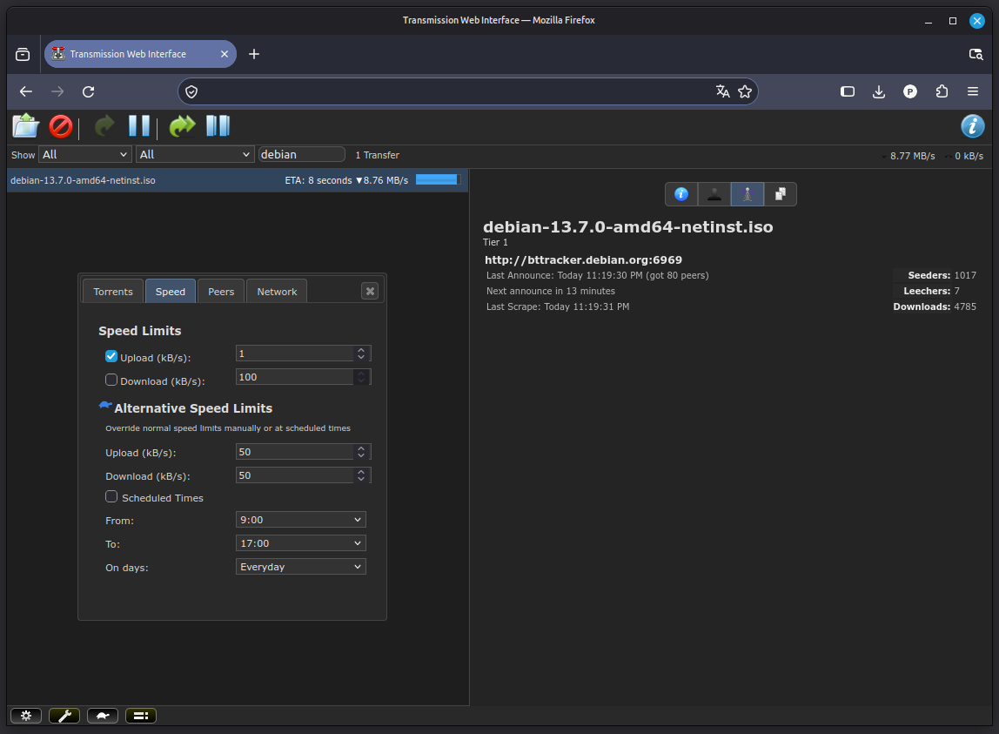

# Transmission-dark-css



Lightweight CSS override for the Transmission 3.x web client. Refreshes the default transmission-daemon WebUI with a dark theme. Just add the stylesheet and reload.

Originally tested with **transmission-daemon 3.00 (bb6b5a062e)**. Compatibility with other versions has not been verified. Not compatible with Transmission 4.x, which ships a completely new WebUI.

## Installation

1. Back up Transmission's web interface HTML file:

   ```bash
   sudo cp -a /usr/share/transmission/web/index.html /usr/share/transmission/web/index.html.bak
   ```

2. Copy the stylesheet to the Transmission web assets directory:

   ```bash
   sudo install -m 644 custom-dark.css /usr/share/transmission/web/style/transmission/custom-dark.css
   ```

3. Edit `/usr/share/transmission/web/index.html` and add this line **after the other stylesheets**, inside `<head>`:

   ```html
   <link rel="stylesheet" href="./style/transmission/custom-dark.css">
   ```

4. Reload the web interface (use a hard refresh if the previous stylesheet is cached).

## Notes

- The theme overrides the existing interface styles; it does not replace Transmission's original CSS files.
- Transmission package updates may overwrite `index.html`, requiring the link to be added again.
- The installation paths shown are for Debian/Ubuntu packages and may differ on other distributions.

## License

This project is licensed under the GNU General Public License
version 3 (GPL-3.0-only). See [COPYING](COPYING).

Based on the Transmission WebUI stylesheet:
https://github.com/transmission/transmission
